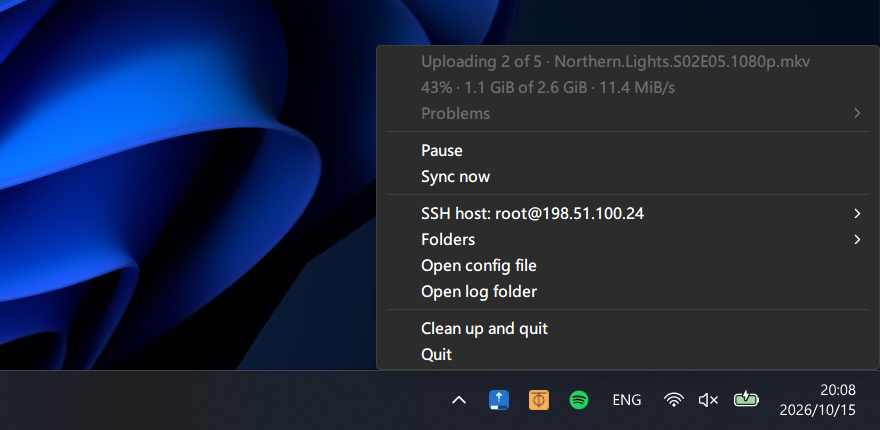

# outbound

[](https://github.com/shalemore/outbound/actions/workflows/ci.yml)
[](LICENSE)

> [!WARNING]
> Early development: the design and docs are still in flux, and breaking changes are likely.



A Windows tray app that moves files from local folders to a folder on a Linux server over ssh. A file goes to the Recycle Bin once the server has an identical copy.

- **No server setup.** It uses your system `ssh`, so nothing is installed on the server.
- **Verified.** Every upload is checked with sha256 before it appears.
- **Resumable.** An interrupted upload continues where it stopped, and failures are retried.
- **Never overwrites.** A different file with the same name is a conflict, not a replacement.

## Install

```sh
scoop bucket add shalemore https://github.com/shalemore/scoop-bucket
scoop install outbound
```

Or download the portable `.exe` from [Releases](https://github.com/shalemore/outbound/releases) and run it.

> [!NOTE]
> The `.exe` is not code-signed, so SmartScreen may warn about a browser download. Choose "More info", then "Run anyway". Installing with Scoop avoids this.

## Quick start

> [!IMPORTANT]
> The server must run Linux. macOS, BSD and Windows servers are not supported.

> [!NOTE]
> outbound never asks for a password. Connect to the server once from a terminal first, to accept its host key.

Run `outbound`. The first run writes a configuration template and lists it as a problem in the tray menu. Then:

1. Pick the ssh host in the menu (it lists the aliases of `~/.ssh/config`).
2. Add a folder: choose the local folder, then the folder on the server, which must already exist.

## Tray icon

A strip on the icon is the progress bar, and its color is the state: teal idle, blue syncing, amber conflicts, red problems, gray paused. In the **Problems** submenu, a click on a problem copies its full text, and a click on a conflict shows the file in Explorer.

## Configuration

`%APPDATA%\outbound\config.toml`. The menu edits it in place and keeps your comments, and a change, also one made by hand, takes effect within seconds. The log is `%LOCALAPPDATA%\outbound\outbound.log`; at 5 MiB it becomes `outbound.log.old` and a new one is started.

```toml
# Global settings, all optional (defaults shown). Keep them above the first table.
scan_interval_secs = 30       # folders are also watched, so new files are noticed at once
settle_secs = 60              # upload a file once it has been left alone this long
ignored_extensions = ["part", "crdownload", "tmp", "!qb", "aria2", "downloading", "opdownload"]
notifications = true
retries = 3
retry_delay_secs = 2          # doubles with every retry, up to a minute
# bandwidth_limit = "10 MiB/s"

[ssh]
destination = "user@example.com"   # or an alias from ~/.ssh/config
# port = 22
# identity_file = "C:/Users/you/.ssh/id_ed25519"

[[mapping]]
local = "D:/Downloads/outbox"
remote = "/data/videos"
# enabled = false             # keep the mapping but ignore it
# settle_secs and ignored_extensions can be set here too
```

## Notes

- Files on the server are never deleted or modified.
- A file that conflicts with a different file on the server stays where it is.
- A folder that is dropped in is sent with everything in it, and removed once it is empty and has been left alone for the settle time.
- Hidden and system files, such as `desktop.ini` and `Thumbs.db`, are not sent.
- A `.part` file left on the remote after its source was deleted is not cleaned up.

## Uninstall

`scoop uninstall outbound` is all you need. If you used the `.exe` directly, choose **Clean up and quit** in the tray menu first, then delete the file. Your configuration and log are kept.

## License

[MIT](LICENSE)
